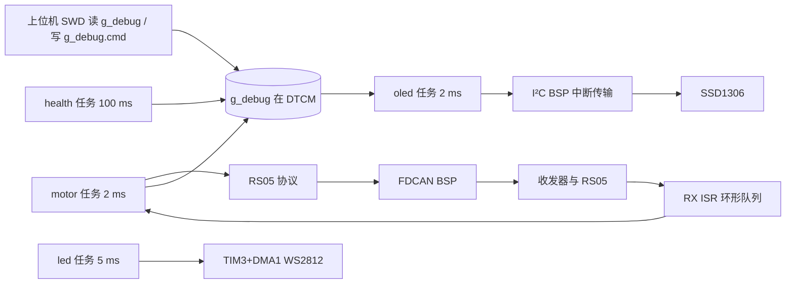

# 架构、任务与维护

## 目录与责任

```text
Core/             CubeMX 初始化、异常/IRQ、启动入口、RTOS 任务创建
App/              app_main.c 各服务入口、app_motor.c 电机状态机、app_led.c 灯效
                  app_tasks.c 线程表/周期、app_display.c RTOS 屏页面
                  app_rtos_stats.c 调度统计（CPU 占用/状态/栈/切换次数）
BSP/              FDCAN 有界收发、I²C 中断传输/总线恢复、TIM2 计时、WS2812 DMA
Devices/          RS05 协议编解码、SSD1306 页缓冲与字形
MDK-ARM/          Keil 工程、启动汇编、scatter、构建产物
Middlewares/      FreeRTOS 内核 + CMSIS-RTOS2 适配
Drivers/          ST HAL 与 CMSIS
Tools/            flash_and_verify.py（烧写后 SWD 只读验收）、read_oled_page.py（帧缓冲回读）、test_display.c（PC 版面检查）
Docs/             交付文档、历史记录、许可证
```

`App/app_motor.c`、`app_led.c`、`BSP/*`、`Devices/*`、`app_debug.*`、`app_config.h` 与 `RobStride05_H743_HAL` 单线程工程**代码逻辑相同**（2026-10-22 起本工程补了详尽中文注释，去注释后逐字一致；同步时以代码为准，不要整文件覆盖）；RTOS 版只把这些服务从“主循环顺序调用”改成“每服务一个周期任务”，差异集中在 `Core/Src/main.c`、`Core/Src/freertos.c`、`App/app_tasks.c`、`App/app_main.c` 的入口拆分，以及 RTOS 专用的 `App/app_display.c` 屏幕页面与 `App/app_rtos_stats.c` 调度统计。



## 任务与时间预算

| 任务 | 优先级（CMSIS/FreeRTOS） | 栈（字节） | 周期 | 行为 |
|---|---|---|---|---|
| motor | AboveNormal / 32 | 2048 | 2 ms | 收帧、安全检查、命令提交、单笔 CAN 事务、20 ms 速度斜坡、100 ms 参数轮询、20 ms 发布快照 |
| oled | Normal / 24 | 3072 | 2 ms | 5 Hz 整屏刷新，每段 129 B 由 I²C 中断发送；失败退避 500 ms，连续 3 次后 2 s |
| health | BelowNormal / 16 | 1024 | 100 ms | 系统健康位、`health_heartbeat` |
| led | Low / 8 | 1536 | 5 ms | 50 fps 灯效；波形缓冲在 D2 SRAM1，由 DMA 异步发送 |

实测（2026-10-22，200 MHz）：电机任务单次服务 10–32 µs，2 ms 周期约占 1.6% CPU；`loop_heartbeat` 与 `tick_ms` 由电机任务发布，上位机用它确认调度器仍在运行。任务内**没有任何阻塞等待**：CAN 发送是最多 5 ms 的超时轮询，I²C 由中断完成，WS2812 由 DMA 完成。

`osDelayUntil` 以绝对 tick 维持周期；若某次服务超期，直接重新对齐到下一拍，不做“补跑”，避免一个被调试暂停的任务恢复后连续快发帧。

## 通信与保护

- CAN：单笔事务，最多 20 个有界步骤（准备/使能的读回核对）；RX 由 ISR 搬入 32 帧环形队列（单次 ISR 最多 16 帧），任务一次最多取 32 帧。TX 用 `TXBTO` 确认真正上总线，不是只看进 FIFO；超时则 abort 并报 `RESULT_TX`。
- 反馈年龄 ≥150 ms 视为离线；使能态下离线/故障/超速/模式不符/健康位非零都立即 trip 并发送类型 4 停止帧。
- Bus-off：每秒最多恢复一次，恢复后保持失能，必须重新「准备 → 使能」。
- 服务间断：TIM2 1 MHz 自由计数，两次服务间隔 >100 ms（例如调试暂停后恢复）立即撤销命令与目标并 trip `RESULT_SERVICE_GAP`。这是恢复后的检查，**不是** CPU 停住期间的保护；停住期间只靠电机侧超时。
- 减速停止（STOP）按已准备的加速度降到零并保持使能；立即失能（DISABLE）发送类型 4 停止帧并撤销准备。CLEAR_FAULT 只发送一次清错请求，不自动使能。

状态机与上位机一致：0 DISABLED、1 PREPARED、2 ENABLED、3 RUNNING、4 STOPPING、5 FAULT、6 CONFIGURING、7 ENABLING。RUN 一次提交在 MCU 内保持，直到停止、失能或故障；没有时间窗口续期。

## OLED 与 I²C

I²C 全程中断传输，每次 4 B 命令或 129 B 数据段；任务只做状态机（开始下一段 / 判完成），不发忙等。失败时禁 IRQ、禁外设、复位 I²C 再起恢复：SCL/SDA 切开漏，最多 9 个时钟 + 一次 STOP，每步隔 1 ms，随后重初始化；总线仍被拉低则退避重试。OLED 缺失或 NACK 不会阻塞电机任务，也不影响灯带。

I²C ACK 与刷新计数不能证明面板真亮或内容正确，仍需看屏确认（可用 `python Tools/read_oled_page.py` 从 RAM 回读帧缓冲并解码成文字核对）。

## OLED 页面（0.96" 128×64，RTOS 版）

版面由 `App/app_display.c` 生成：5×7 字形 + 1 列间隔 = **每行 21 字符、共 8 行**；字形表里没有小写字母和 `%`，所以全部大写、只用 `+ - . / :` 与空格。所有行经 22 字节缓冲 `snprintf` 生成，超长只会被截断，不会串行。

| 行 | 内容 | 说明 |
|---|---|---|
| 0 | `UP 00:00:08 SW 15763` | 运行时长 + **上电以来上下文切换次数**（低 5 位，约 1800–2000 次/秒，画面里每帧跳约 360） |
| 1 | `HEAP 16.0K MIN 16.0K` | `xPortGetFreeHeapSize()` / 历史最小；两者长期不变=无泄漏 |
| 2 | `MOTOR  BLK 1.2 S1.5K` | 线程名、当前状态、**CPU 占用 1.2%**、剩余栈 1.5 KB |
| 3 | `OLED   RUN 1.3 S1.9K` | 同上；它正在画这一帧，所以是 RUN |
| 4 | `HEALTH BLK 0.0 S0.8K` | 100 ms 周期、每次几微秒，占用显示 0.0 |
| 5 | `LED    BLK 0.8 S1.3K` | 同上 |
| 6 | `MOT ONLINE  V+0.043` | 只在反馈新鲜（<150 ms）时显示实测速度，否则 `MOT OFFLINE V  ---` |
| 7 | `SET +0.000 RAD/S DIS` | 目标速度 + 应用状态（DIS/PRE/ENA/RUN/STP/FLT/CFG/ENG） |

`App/app_rtos_stats.c` 提供这些数字，全部来自调度器自己的账本：

- **状态 / 栈余量 / CPU 占用** = `uxTaskGetSystemState()`：`eCurrentState`、`usStackHighWaterMark`、`ulRunTimeCounter`。
- **CPU 占用** 需要 `configGENERATE_RUN_TIME_STATS=1`，计数器用 Cortex-M7 的 `DWT->CYCCNT`（200 MHz，32 位，21.5 s 回绕；只做无符号差值，200 ms 窗口无影响）。FreeRTOS 每次任务切换读一次该计数器，任务累计运行时间精确到 5 ns。
- **SW 切换次数** = `traceTASK_SWITCHED_IN()` 钩子里的 `g_rtos_switch_count++`，每次上下文切换 +1，无 RTOS 调用、无 Cache 维护。
- 占用百分比 = 本任务窗口增量 / 所有任务（含 IDLE、Tmr Svc）窗口增量之和，**分母就是真实流逝的 CPU 时间**，所以各任务百分比之和 ≈ 100 − IDLE。

为什么屏幕不显示"此刻正在跑的线程名"：采样者本身正在运行，直接读当前 TCB 永远只会得到画屏这个线程（OLED）。要"看到谁在跑"，正确做法是看调度器分配的时间片（CPU 占用）与状态（RUN/BLK），也就是上表 2–5 行。

PC 侧检查：`gcc -std=c99 -Wall -Wextra -Werror -Wno-format-truncation Tools/test_display.c App/app_display.c -IApp -IBSP -IDevices -o Tools/test_display.exe && Tools/test_display.exe`，它会用真实格式化代码打出 8 行，并检查每行 ≤21 字符、每个字符都存在于字形表。

上板核对：`python Tools/read_oled_page.py [--png Docs/oled_page_preview.png]` 从 RAM 回读 `pixels`（本版 `0x20007940`，1024 B）并反解；`Docs/oled_page_preview.png` 就是按帧缓冲渲染的屏面预览。

## 时钟、中断、Cache 与内存

- HSE 25 MHz → PLL1 M=5/N=160/P=4，CPU 200 MHz；HCLK 100 MHz、APB 50 MHz；VOS1、LDO；PLL1Q=80 MHz 给 FDCAN；I²C 用 HSI64。
- `SystemCoreClock` 由 `HAL_RCC_ClockConfig` 更新为 200 MHz，FreeRTOS `configCPU_CLOCK_HZ=SystemCoreClock`，SysTick 1 kHz。
- **HAL tick 用 TIM6（优先级 15）**，SysTick 只属于 FreeRTOS 端口，`SysTick_Handler` 只调用 `xPortSysTickHandler`；`HAL_TIM_PeriodElapsedCallback` 负责 `HAL_IncTick`，删除它会使 `HAL_GetTick` 停摆。
- NVIC 分组 4；`configLIBRARY_MAX_SYSCALL_INTERRUPT_PRIORITY=5`。FDCAN1_IT0 与 I²C2 EV/ER 均为 5，可被临界区屏蔽，也允许将来从 ISR 调 `FromISR` 接口；当前 ISR 内没有 RTOS 调用。
- **Cache：I-Cache 与 D-Cache 都不开启，源码中没有使能、关闭、clean、invalidate 调用**，`SCB->CCR` 只作只读记录（`g_debug.system.ccr`、`g_debug.motor.cpu_dcache_enabled`、WS2812 初始化前置检查）。这既是原始故障的根因规避（实测复现与机理见 [08_Cache为什么会HardFault.md](08_Cache为什么会HardFault.md)），也是 WS2812 DMA 缓冲一致性的前提。
- Scatter（`MDK-ARM/RobStride05_H743.sct`）：Flash `0x08000000` 2 MB；RW/ZI、24 KB FreeRTOS heap、任务栈、`g_debug` 在 DTCM `0x20000000` 128 KB；`WS2812_DMA` 单独放在 D2 SRAM1 `0x30000000` 且为 **UNINIT**（CRT 不会在 SRAM1 时钟使能前写它）。
- TIM2 由 BSP 独占，1 MHz、32 位、无 IRQ；初始化时取消调试冻结。不要在 CubeMX 中另用 TIM2，调试时不要冻结 TIM2。

## 上位机 ABI（`App/app_debug.h`）

`g_debug` 是唯一被 SWD 读写的根结构，布局与 HAL 工程逐字节相同（396 字节）：

- `cmd`（偏移 0，28 字节）：写序号 → 参数 → 新偶数序号最后提交；固件要求连续两次一致快照才执行，并记录 `executed_seq/result`。
- `motor`（偏移 28，280 字节）：`snapshot_seq` 奇数时正在发布，固件每 20 ms 保持一次稳定快照，上位机读前后序号必须相同且为偶数；`can` 之前的 148 字节是连续控制/遥测区。
- `oled`（偏移 308，40 字节）、`system`（偏移 348，48 字节）。
- `system.boot_stage`：1 入口、2 HAL、3 时钟、4 GPIO、5 CAN、6 I2C、7（旧）、8 应用初始化、**9 就绪**。上位机只接受 9 且 `fatal=0`。
- `system.fatal`：见 `App/app_main.h` 的 `APP_FATAL_*`（1 时基、2 HAL/时钟、3 内核、4 任务创建、5 堆、6 栈、7 断言、8 内核未接管、9–13 异常）。
- `system.ccr`：只读快照，正常为 `0x40200`（STKALIGN + BP，IC/DC 均为 0）。
- `g_debug` 的地址由链接器决定（本版 `0x2000009C`），上位机每次连接都从 AXF 的 DWARF 重新解析，不要手写固定地址。

## 维护与重新生成

- 改限值/ID：`App/app_config.h`；上位机的 `LIMITS/DEFAULTS` 需同步。
- 改周期/栈/优先级：`App/app_tasks.c` 顶部宏；总栈需求要小于 24 KB heap。
- 新增任务：`App/app_tasks.c` + `App/app_main.c` 的服务函数，保持“服务函数不阻塞”。
- CubeMX 重新生成会带回：`defaultTask`（本工程不再使用）、`SCB_EnableICache()`（.ioc 已改为 Disabled，仍要复查 `main.c`）、FDCAN/I²C 优先级（需保持 5）、`main.c` 的启动阶段标记与 `App_Init/osKernelInitialize` 顺序。每次 Generate Code 后按本文件逐项核对再编译，**不要直接用未核对的生成结果上板**。
- 编译：Keil ARMCC 5.06u7、C99、-O0；工程内含全部 HAL/CMSIS/FreeRTOS 源码与 CM7 r0p1 端口，不依赖外部仓库。
